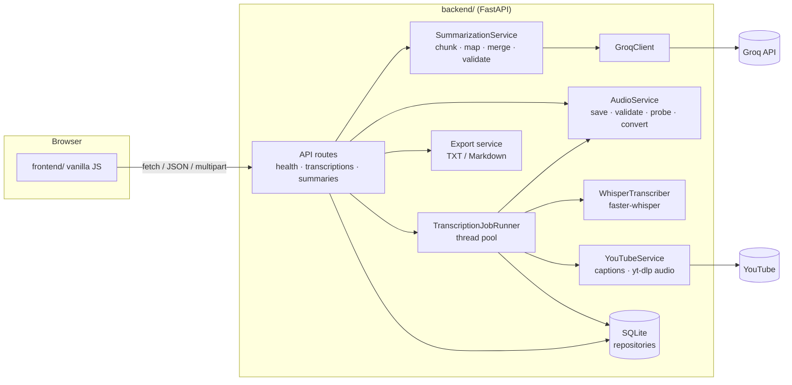

# Transmint

**Transmint** turns meeting recordings, lectures and **YouTube videos** into transcripts and structured summaries.

- **Input** is an audio file upload **or a YouTube link**. For YouTube, Transmint uses the video's own captions when they exist, and otherwise downloads just the audio and transcribes it. No YouTube API key is needed.
- **Transcription** runs locally with [faster-whisper](https://github.com/SYSTRAN/faster-whisper) (no audio leaves your machine).
- **Summarization** uses the [Groq](https://console.groq.com) API to produce validated, structured summaries: an overview, key points, concepts, decisions, suggestions, action items, follow-up questions and unclear parts.

The project has two independent parts:

| Folder | What it is |
| --- | --- |
| [`backend/`](backend/) | Python FastAPI service: uploads, background transcription jobs, summarization, SQLite storage, exports. Usable on its own via REST or `/docs`. |
| [`frontend/`](frontend/) | A minimal vanilla HTML/CSS/JS demo client. No framework or build step. |

**Just want to run it?** Go to [How to run (step by step)](#how-to-run-step-by-step).

## Features

- Paste a YouTube link (`watch`, `youtu.be`, `shorts`, `live`, `embed`). Captions are tried first because they are instant and often more accurate; videos without captions fall back to audio download plus Whisper. The video title and duration are recorded.
- Upload WAV, MP3, M4A, FLAC, OGG or WebM audio (checked by extension, file signature and a real decode probe, with a size limit).
- Background transcription jobs (`queued → processing → completed | failed`) with a status endpoint for polling.
- Transcript with detected language, duration and timestamped segments.
- Three summary types: `brief`, `detailed` and `meeting_notes`, plus an optional output language.
- Long transcripts are split into chunks and summarized hierarchically (map → merge), so no single prompt is oversized.
- A careful prompt that treats the transcript as untrusted data, keeps decisions separate from suggestions, and never invents owners or deadlines. A post-check also removes owners/deadlines that don't appear in the transcript.
- Every LLM response is validated against a Pydantic schema, with one automatic repair attempt.
- TXT and Markdown export for transcripts and summaries.
- Clear HTTP errors for invalid files, missing dependencies or credentials, upstream rate limits and timeouts.

## Architecture



The request flow:

1. `POST /api/transcriptions` streams the upload to `backend/data/uploads/<uuid>.<ext>`, validates it, creates a `queued` record and returns `202` right away.
2. A worker thread marks the job `processing`, transcribes it, stores the result (`completed`) or the error (`failed`), and **always deletes the temporary file**.
   *For a YouTube link* (`POST /api/transcriptions/youtube`), the worker first tries the video's caption track. If there is none, it downloads the audio-only stream into the same temporary folder and transcribes it like an upload.
3. The client polls `GET /api/transcriptions/{id}/status`, then fetches the full record.
4. `POST /api/summaries` loads the transcript, chunks it if needed, calls Groq, validates the JSON and stores the summary.

All SQL is isolated in `backend/app/db/`, so the storage can move to PostgreSQL later without changing routes or services.

## Tech stack

- Python 3.11 to 3.13 (tested on 3.12), FastAPI, Uvicorn, Pydantic v2, pydantic-settings
- faster-whisper 1.2 (CTranslate2), with PyAV for decoding (FFmpeg libraries bundled)
- Groq Python SDK (default model `openai/gpt-oss-120b`; configurable)
- SQLite (Python standard library)
- Pytest and httpx for tests
- Vanilla HTML, CSS and JavaScript for the frontend

## Prerequisites

- **Python 3.11, 3.12 or 3.13.** Python 3.14 may not have wheels for all dependencies yet.
- **FFmpeg CLI is optional.** PyAV, installed automatically, ships the FFmpeg libraries and decodes all the supported formats. If `ffmpeg`/`ffprobe` are on your `PATH`, Transmint also uses them as a fallback for files PyAV can't open (`brew install ffmpeg` / `sudo apt install ffmpeg`).
- **Internet access on the first transcription**, to download the Whisper model from Hugging Face (~145 MB for `base`). After that it is cached.
- **For YouTube (recommended): [Deno](https://deno.com)** (`brew install deno`). yt-dlp uses a JavaScript runtime to solve YouTube's player challenges; Node.js 22+ or Bun also work. Without one, downloads may still work, but some formats can be missing. Caption fetching doesn't need it.
- **A Groq API key** for summaries. You can get one free at <https://console.groq.com/keys>. Transcription works without it.

## How to run (step by step)

You will use **two terminals**: one for the backend (API) and one for the frontend (web page).

### Step 1: Check the prerequisites

```bash
python3.12 --version        # Python 3.11, 3.12 or 3.13 is required (3.14 is not supported yet)
```

- macOS: `brew install python@3.12` if it's missing. Windows/Linux: install Python 3.12 from <https://www.python.org/downloads/>.
- Optional, for reliable YouTube downloads: `brew install deno` (or see <https://deno.com>).
- Optional: `brew install ffmpeg`, only needed for unusual audio files.
- A free Groq API key from <https://console.groq.com/keys>, for summaries.

### Step 2: Get the code

```bash
git clone <your-repo-url> transmint
cd transmint
```

### Step 3: Install the backend (one time)

```bash
cd backend
python3.12 -m venv .venv
source .venv/bin/activate          # Windows: .venv\Scripts\activate
pip install --upgrade pip
pip install -r requirements.txt
```

Your prompt should now start with `(.venv)`.

### Step 4: Configure your API key (one time)

```bash
cp .env.example .env               # Windows: copy .env.example .env
```

Open `backend/.env` in an editor and set your key:

```
GROQ_API_KEY=gsk_your_real_key_here
GROQ_MODEL=openai/gpt-oss-120b
```

Leave everything else as it is. All other settings have working defaults; see [Configuration](#configuration).

### Step 5: Start the backend (terminal 1)

```bash
cd backend                         # from the project root
source .venv/bin/activate
uvicorn app.main:app --reload --port 8000
```

Wait for `Application startup complete.`, then check it in a browser:

- <http://127.0.0.1:8000/api/health> should show `"status":"ok"` and `"summarization_configured":true`
- <http://127.0.0.1:8000/docs> shows the interactive API documentation

`http://127.0.0.1:8000/` itself returns `{"detail":"Not Found"}`. That is expected, because the API lives under `/api/...`. Keep this terminal open.

### Step 6: Start the frontend (terminal 2)

Open a **second** terminal and run the server **from inside the `frontend` folder**:

```bash
cd frontend                        # from the project root
python3 -m http.server 5500
```

Or, from any folder: `python3 -m http.server 5500 --directory /path/to/transmint/frontend`.

> Don't just double-click `index.html`. Pages opened from `file://` are blocked by the backend's CORS rules.

### Step 7: Open the app

Go to **<http://127.0.0.1:5500>**. The line under the title should say **"Backend 0.1.0 connected at http://127.0.0.1:8000"**.

### Step 8: Use it

1. **Choose an input**
   - **Audio file:** pick or drag a WAV, MP3, M4A, FLAC, OGG or WebM file (up to 100 MB).
   - **YouTube link:** paste a video URL. Keep *"Use the video's captions when available"* ticked for speed, or untick it to always transcribe the audio with Whisper.
2. Click **Transcribe** and wait for the transcript. The **first** run downloads the Whisper model (~145 MB), so it is slower.
3. Pick a summary type (**Brief**, **Detailed** or **Meeting Notes**). Optionally type an output language such as `English`, which is useful for Hindi or other non-English videos.
4. Click **Summarize**. Long videos can take about a minute.
5. Use the **Download** buttons to save the transcript or summary as TXT or Markdown.

### Stopping and restarting

- Stop either server with `Ctrl+C` in its terminal.
- **After editing `backend/.env`, restart the backend** (`Ctrl+C`, then run `uvicorn` again). `--reload` only watches `.py` files, so it won't pick up `.env` changes.
- Next time you only need Step 5 and Step 6. Installation and configuration are one-time.

### Running the tests

```bash
cd backend
source .venv/bin/activate
pytest
```

### Troubleshooting

| Problem | Cause and fix |
| --- | --- |
| `Address already in use` / port 8000 busy | Another program uses the port. Find it with `lsof -nP -iTCP:8000 -sTCP:LISTEN` and stop it, **or** start the backend on another port (`--port 8001`) and open the page as `http://127.0.0.1:5500/?api=http://127.0.0.1:8001`. |
| Browser shows **"Error response 404 – File not found"** on port 5500 | The frontend server was started in the wrong folder. Stop it and run `python3 -m http.server 5500` **inside `frontend/`**. |
| Page says **"Cannot reach the backend…"** | The backend isn't running, runs on a different port (use `?api=`), or the page's address isn't in `CORS_ORIGINS`. Use `http://127.0.0.1:5500` or `http://localhost:5500`, not `file://` or `[::]`. |
| **"summarization not configured (set GROQ_API_KEY)"** although the key is set | The backend was started before the key was added. Restart it. Also check that the key is in `backend/.env`, not in the project root. |
| **"Groq model '…' is not available"** | Groq retired that model. Set `GROQ_MODEL` in `backend/.env` to a current one from <https://console.groq.com/docs/models> (default: `openai/gpt-oss-120b`) and restart. |
| **"Groq rate limit reached"** (429) | The free-tier limit was hit. Wait a minute and try again. |
| First transcription is slow or fails offline | The Whisper model downloads on first use and needs internet once. |
| YouTube: **"asking for a sign-in/bot check"** | Export your browser's YouTube cookies to `cookies.txt` and set `YTDLP_COOKIES_FILE=/path/to/cookies.txt` in `backend/.env`, then restart. |
| YouTube downloads fail after a while | YouTube changed something. Run `pip install -U "yt-dlp[default]"` in the backend venv and restart. Installing Deno also helps. |
| `pip install` fails building packages | You're probably on Python 3.14. Recreate the venv with `python3.12 -m venv .venv`. |

## Configuration

All settings are environment variables, read from `backend/.env`. See [`backend/.env.example`](backend/.env.example) for the full list.

| Variable | Default | Purpose |
| --- | --- | --- |
| `GROQ_API_KEY` | *(none)* | Required for summaries. Get one at https://console.groq.com/keys |
| `GROQ_MODEL` | `openai/gpt-oss-120b` | Any chat model listed at https://console.groq.com/docs/models |
| `GROQ_TIMEOUT_SECONDS` / `GROQ_MAX_RETRIES` | `60` / `2` | Timeout per request; SDK retries with backoff on 429/5xx |
| `WHISPER_MODEL_SIZE` | `base` | `tiny`, `base`, `small`, `medium`, `large-v3`, `turbo` |
| `WHISPER_DEVICE` / `WHISPER_COMPUTE_TYPE` | `auto` / `int8` | Use `cuda` / `float16` on an NVIDIA GPU |
| `WHISPER_LANGUAGE` | *(auto)* | Force a language code such as `en` |
| `MAX_UPLOAD_MB` | `100` | Upload size limit |
| `YOUTUBE_ENABLED` | `true` | Turn YouTube input on/off |
| `YOUTUBE_PREFER_CAPTIONS` | `true` | Use captions when available (the request can override it) |
| `YOUTUBE_CAPTION_LANGUAGES` | `en` | Preferred caption languages, e.g. `en,hi`; any track is the fallback |
| `YOUTUBE_MAX_DURATION_MINUTES` / `YOUTUBE_MAX_DOWNLOAD_MB` | `180` / `500` | Limits for audio downloads |
| `YTDLP_JS_RUNTIMES` | `deno,node,bun` | JS runtimes yt-dlp may use |
| `YTDLP_COOKIES_FILE` | *(none)* | Optional `cookies.txt` if YouTube asks for a sign-in/bot check |
| `MAX_CONCURRENT_TRANSCRIPTIONS` | `1` | Worker threads for transcription |
| `SUMMARY_CHUNK_CHARS` | `12000` | Chunk size for hierarchical summarization |
| `MAX_TRANSCRIPT_CHARS` | `400000` | Longest transcript accepted for summarization |
| `CORS_ORIGINS` | `http://127.0.0.1:5500,http://localhost:5500` | Comma-separated allowed browser origins |
| `RATE_LIMIT_PER_MINUTE` | `20` | Per-IP limit on uploads and summaries (`0` disables) |
| `DATABASE_PATH` / `UPLOAD_DIR` | `data/transmint.db` / `data/uploads` | Relative to `backend/` |

Never commit `backend/.env`; it is git-ignored.

The frontend's backend URL is `DEFAULT_API_BASE_URL` at the top of [`frontend/script.js`](frontend/script.js) (default `http://127.0.0.1:8000`). You can also override it per visit with `?api=http://host:port`. If you serve the frontend from another address, add that origin to `CORS_ORIGINS`.

## API reference

Errors always look like `{"detail": "<message>", "code": "<machine_code>"}`. The exception is request-schema errors (422 from FastAPI), where `detail` is a list.

| Method & path | Description | Success |
| --- | --- | --- |
| `GET /api/health` | Liveness, version and capability flags | 200 |
| `POST /api/transcriptions` | Upload audio (multipart field `file`) and start a job | 202 |
| `POST /api/transcriptions/youtube` | Start a job from a YouTube link: `{"url": "...", "prefer_captions": true}` | 202 |
| `GET /api/transcriptions/{id}` | Full record: status, transcript, language, duration, segments | 200 |
| `GET /api/transcriptions/{id}/status` | Lightweight status for polling | 200 |
| `GET /api/transcriptions/{id}/export?format=txt\|md` | Download the transcript | 200 |
| `POST /api/summaries` | Summarize by `transcription_id` or raw `text` | 201 |
| `GET /api/summaries/{id}` | Retrieve a stored summary | 200 |
| `GET /api/summaries/{id}/export?format=md\|txt` | Download the summary | 200 |

Common error codes: `404` not found · `409` transcription not completed yet · `413` file too large · `415` unsupported or undecodable audio · `422` invalid input · `429` rate limited (ours or Groq's; includes `Retry-After` when known) · `502` LLM failure or invalid output · `503` Whisper or Groq not available/configured · `504` Groq timeout.

### Examples

**Health**

```bash
curl http://127.0.0.1:8000/api/health
```

```json
{"status":"ok","app":"Transmint","version":"0.1.0","transcription_available":true,"youtube_available":true,"summarization_configured":true}
```

**Upload and transcribe**

```bash
curl -F "file=@lecture.mp3" http://127.0.0.1:8000/api/transcriptions
```

```json
{"id":"d7f4aba03a9e4554b2469a1c96186d05","status":"queued","error":null,
 "created_at":"2026-10-10T07:45:09.515898Z","updated_at":"2026-10-10T07:45:09.515898Z",
 "original_filename":"lecture.mp3","text":null,"language":null,"duration_seconds":null,"segments":[]}
```

**Transcribe a YouTube video**

```bash
curl -X POST http://127.0.0.1:8000/api/transcriptions/youtube \
  -H "Content-Type: application/json" \
  -d '{"url":"https://www.youtube.com/watch?v=jNQXAC9IVRw"}'
```

You get the same `202` job shape, with `"source_type":"youtube"` and `"source_url"`. Once completed, the record also has `"title"` and `"transcript_source"`, which is one of `youtube_captions`, `youtube_auto_captions` or `whisper`. Send `"prefer_captions": false` to always transcribe the audio with Whisper.

```json
{"id":"67e11b6898924f4b819583e1d1bb6d7b","status":"completed","source_type":"youtube",
 "source_url":"https://www.youtube.com/watch?v=jNQXAC9IVRw","title":"Me at the zoo",
 "transcript_source":"youtube_captions","language":"en","duration_seconds":19.0,
 "text":"All right, so here we are, in front of the elephants ...","segments":[...]}
```

**Poll status**

```bash
curl http://127.0.0.1:8000/api/transcriptions/d7f4aba03a9e4554b2469a1c96186d05/status
```

```json
{"id":"d7f4aba03a9e4554b2469a1c96186d05","status":"completed","error":null,
 "created_at":"2026-10-10T07:45:09.515898Z","updated_at":"2026-10-10T07:45:12.468554Z"}
```

**Get the transcript**

```bash
curl http://127.0.0.1:8000/api/transcriptions/d7f4aba03a9e4554b2469a1c96186d05
```

```json
{"id":"d7f4aba03a9e4554b2469a1c96186d05","status":"completed","error":null,
 "original_filename":"lecture.mp3","language":"en","duration_seconds":16.869,
 "text":"Good morning, everyone. Today's lecture covers entropy in thermodynamics. ...",
 "segments":[{"start":0.0,"end":1.88,"text":"Good morning, everyone."},
             {"start":1.88,"end":5.48,"text":"Today's lecture covers entropy in thermodynamics."}],
 "created_at":"...","updated_at":"..."}
```

**Summarize a stored transcription**

```bash
curl -X POST http://127.0.0.1:8000/api/summaries \
  -H "Content-Type: application/json" \
  -d '{"transcription_id":"d7f4aba03a9e4554b2469a1c96186d05","summary_type":"meeting_notes","output_language":"English"}'
```

**Summarize raw text**

```bash
curl -X POST http://127.0.0.1:8000/api/summaries \
  -H "Content-Type: application/json" \
  -d '{"text":"Priya will prepare the migration plan by Friday. We agreed to postpone the mobile release.","summary_type":"brief"}'
```

```json
{
  "id": "8c1e0f5d2b7a4e9c8d3f6a1b2c4d5e6f",
  "transcription_id": null,
  "summary_type": "brief",
  "output_language": null,
  "model": "openai/gpt-oss-120b",
  "chunk_count": 1,
  "content": {
    "overview": "The team agreed to postpone the mobile release; Priya will prepare the migration plan.",
    "key_points": ["Mobile release postponed", "Migration plan due Friday"],
    "important_concepts": [{"term": "Migration plan", "explanation": "Plan to be prepared by Priya."}],
    "decisions": ["Postpone the mobile release"],
    "suggestions": [],
    "action_items": [{"task": "Prepare the migration plan", "owner": "Priya", "deadline": "by Friday"}],
    "follow_up_questions": [],
    "uncertainties": []
  },
  "created_at": "2026-10-10T08:00:00.000000Z"
}
```

**Retrieve and export**

```bash
curl http://127.0.0.1:8000/api/summaries/8c1e0f5d2b7a4e9c8d3f6a1b2c4d5e6f
curl -OJ "http://127.0.0.1:8000/api/summaries/8c1e0f5d2b7a4e9c8d3f6a1b2c4d5e6f/export?format=md"
curl -OJ "http://127.0.0.1:8000/api/transcriptions/d7f4aba03a9e4554b2469a1c96186d05/export?format=txt"
```

(The summary output shown above is illustrative; actual wording depends on the model.)

## Tests

Run them as shown in [Running the tests](#running-the-tests). The suite fakes both Whisper and Groq, so it needs no network, model download or API key. It covers health and CORS, upload validation (extension, signature, corrupt audio, size limit, empty files), the job lifecycle and temp-file cleanup, failure handling (no fabricated transcripts, no leaked internals), chunking and hierarchical summarization, JSON parsing and repair, the owner/deadline guard, prompt-injection delimiting, Groq error mapping (429/504/401/404/5xx, truncated output), summary API validation and errors, exports and rate limiting.

## Security notes

- Upload size is enforced twice: by `Content-Length` before the body is read, and again while streaming to disk. Content is checked by signature and a decode probe.
- Uploaded files are saved under server-generated UUID names; the client filename is only stored, sanitized, for display. Temporary files are deleted after every job, and on startup.
- Export filenames are built from IDs only; there are no filesystem paths in any response.
- CORS allows only the listed origins and methods (no wildcard).
- Secrets come from environment variables only; the health endpoint exposes booleans, never values.
- The frontend renders all transcript and summary text with `textContent`, never `innerHTML`.
- The transcript is wrapped in delimiters and the system prompt tells the model to treat it as data, not instructions.

## Known limitations (V1)

- **Single-process job queue.** Jobs live in an in-memory thread pool. If the server restarts mid-job, that job is marked `failed` on startup and must be re-uploaded. Run a single Uvicorn worker.
- **In-memory rate limiter** that is per process and per IP. It isn't suitable behind a proxy without trusted forwarded headers.
- **No authentication.** Anyone who can reach the API can read any transcript by ID (IDs are random 128-bit values). Don't expose it publicly as-is.
- **Summaries are synchronous.** Very long transcripts make many Groq calls in one request and may hit free-tier token limits (you'll get a clear `429`).
- **CPU transcription is slow** for long recordings with larger models; `base` is a speed/accuracy compromise.
- **YouTube access is best-effort.** YouTube changes often, so keep `yt-dlp` updated (`pip install -U "yt-dlp[default]"`). Servers may be rate-limited or asked for a bot check; set `YTDLP_COOKIES_FILE` if that happens. Private, members-only, region-locked and live videos aren't supported. Only process videos you have the right to use, and respect YouTube's Terms of Service.
- **No speaker diarization**, so action-item owners depend on names being spoken.
- The owner/deadline guard is literal-match based. It may drop a correct but paraphrased deadline; it never adds one.
- PyAV is pinned to 18.x because faster-whisper 1.2.1 uses an argument that PyAV 19 removed.

## Future improvements

- A persistent job queue (e.g. a database-backed queue or arq/RQ) and async summary jobs
- PostgreSQL via the existing repository layer, plus migrations
- Authentication and per-user ownership of transcripts
- Speaker diarization and word-level timestamps
- Streaming progress (SSE/WebSocket) instead of polling
- Docker image and production deployment guide
- A React/Next.js frontend using the same API
